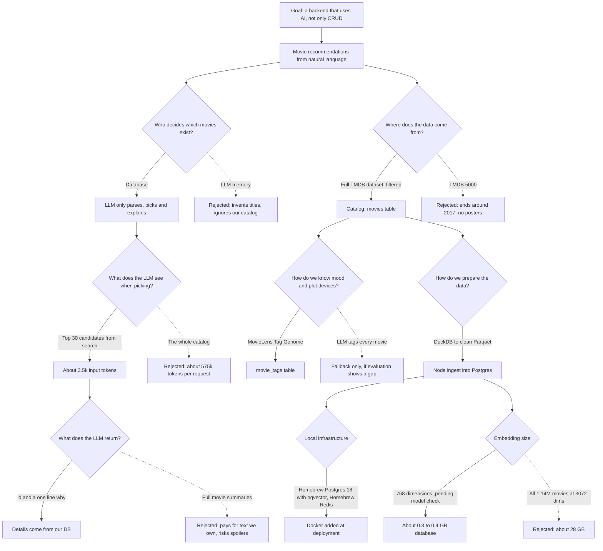

# Decisions

This file records every important decision for the movie recommendation engine: what was decided, what else was considered, and why. It is meant to be read by people (and linked from the README) and by Claude Code before making changes.

Rules:
- Each decision has an ID, a status and a date.
- Status is one of: **Accepted**, **Open** (not decided yet), **Superseded** (replaced by a later decision, with a link).
- Never delete a decision. If it changes, mark the old one Superseded and add a new one.
- New decisions go at the end of their section with the next free ID.

---

## Decision tree

The main choices and the options that were rejected. GitHub renders this diagram automatically.

---

## Product

### D-001 Build a movie recommendation engine driven by natural language
- **Status:** Accepted, 2026-10-09
- **Context:** The goal is a portfolio project that shows backend skills beyond CRUD, by integrating an AI system.
- **Decision:** Users type what they want to watch ("action movie with a twist at the end, not too old") and get recommendations from our own movie database.
- **Alternatives:** Support ticket triage, document Q&A (RAG), natural language e-commerce search, AI features in the Task Manager API.
- **Why:** Easy to demo and understand, and it needs the hard parts of AI backends: ingestion pipelines, hybrid search, slow and unreliable LLM calls, caching, cost control and evaluation.

### D-002 Web client for the demo
- **Status:** Accepted, 2026-10-10
- **Decision:** Vite + React web app.
- **Alternatives:** React Native app.
- **Why:** A link is easier to share and demo than an app. React Native can come later.

### D-003 V1 is anonymous; V2 adds accounts and a personalized landing page
- **Status:** Accepted, 2026-10-10
- **Decision:** V1 has anonymous search only. V2 adds auth, likes and dislikes, a taste profile and "For you" rows.
- **Why:** Gets the core search and AI pipeline working first. Personalization depends on it anyway.

---

## AI design

### D-004 The database is the source of truth; the LLM never adds movies
- **Status:** Accepted, 2026-10-09
- **Decision:** Every recommended movie must exist in our database. The LLM helps understand the request and choose among candidates. Any movie ID it returns that was not in the candidate list is dropped.
- **Alternatives:** Ask the LLM directly for recommendations.
- **Why:** The LLM can invent titles, recommend movies we have no data for, and ignore our filters. Validating IDs makes hallucinated movies impossible.

### D-005 Use Gemini, behind our own provider interface
- **Status:** Accepted, 2026-10-10
- **Decision:** Gemini API for text generation and embeddings. All calls go through `llm/` with an interface (`generateJson`, `embed`); only one file imports the Gemini SDK.
- **Alternatives:** Claude API.
- **Why:** A Gemini key is already available and has a free tier. A Claude subscription does not include API access; that needs a separate Console account with prepaid credits. The interface keeps switching or comparing providers to a one-file change.

### D-006 Send only the top 30 search candidates to the LLM, never the whole catalog
- **Status:** Accepted, 2026-10-10
- **Context:** One movie in compact form is about 100 to 150 tokens.
- **Decision:** Database filters and vector search narrow the catalog to 30 candidates. The LLM picks the best ones from those.
- **Alternatives:** Send the full movie list as input every request.
- **Why:** Full catalog: thousands of movies times ~120 tokens, hundreds of thousands of input tokens per request (about 575k for 4,800 movies). 30 candidates: about 3.5k. Over 150 times cheaper, much faster, fits free tier rate limits, and models choose better from short lists.

### D-007 The LLM returns only IDs and a one-sentence reason
- **Status:** Accepted, 2026-10-10
- **Decision:** Pick output is `{"picks":[{"id":number,"why":string}]}`, with `why` at most 25 words. Title, year, poster, overview and rating come from our database.
- **Alternatives:** Ask for a 2 to 3 sentence summary of each movie.
- **Why:** Output tokens cost more and are slower. We already store the overview, so a summary pays for text we own and risks wrong plot details. The reason ("why it fits this request") is the only part the LLM adds.

### D-008 Two small prompts instead of one master prompt
- **Status:** Accepted, 2026-10-10
- **Decision:** A `parse` prompt (request to filters) and a `pick` prompt (choose and explain). Each is a versioned file; the version is logged with every call.
- **Why:** Each is short, testable and debuggable on its own, and one can change without affecting the other.

### D-009 Token saving rules
- **Status:** Accepted, 2026-10-10
- **Decision:**
  - Short JSON keys and small integer IDs.
  - Candidates sent as compact lines (`id | title | year | genres | tags | overview`), not JSON objects.
  - Structured output mode (response schema) so replies are valid JSON.
  - Thinking set to the lowest level the model allows for parse and pick, because thinking tokens are billed as output.
  - Cache parse results, query embeddings and final results by normalized query.
- **Why:** Each one cuts tokens, retries or latency, and together they keep a search within the free tier.

### D-010 No spoilers in reasons
- **Status:** Accepted, 2026-10-10
- **Decision:** The pick prompt forbids revealing twists, endings or major spoilers. The evaluation set includes checks for it.
- **Why:** A user asking for "a twist at the end" does not want the twist explained.

### D-011 Every AI step has a fallback
- **Status:** Accepted, 2026-10-09
- **Decision:** Parse fails: search with the raw text. Embedding fails: full-text search. Pick fails: return search order without reasons. Budget exceeded: switch AI steps off.
- **Why:** The LLM is slow, rate limited and sometimes returns invalid output. Users should never get an error because of it.

### D-012 A curated tag list in the parse prompt, not the full genome vocabulary
- **Status:** Accepted, 2026-10-10
- **Decision:** The parse prompt lists about 40 hand-picked tags (twist ending, dark, feel-good, slow, atmospheric, and so on), each mapped to Tag Genome tags.
- **Alternatives:** Put all ~1,100 genome tags in the prompt.
- **Why:** The full list would add thousands of input tokens to every request, and many genome tags are too narrow or unsuitable to show users.

### D-013 Translate the search meaning to English during parsing
- **Status:** Accepted, 2026-10-10
- **Decision:** The parse step writes `searchText` in English, so Hindi and Hinglish requests ("koi achhi suspense movie batao") work.
- **Why:** Catalog text is mostly English. A useful demo point for users in India.

### D-040 Gemini models: 3.8 Flash for text, Embedding 2 at 768 dimensions
- **Status:** Accepted, 2026-10-10
- **Decision:** `gemini-3.8-flash` for parse and pick, with thinking at `low`. `gemini-embedding-2` for embeddings, at 768 dimensions. All four are config values (`GEMINI_TEXT_MODEL`, `GEMINI_THINKING_LEVEL`, `GEMINI_EMBEDDING_MODEL`, `EMBEDDING_DIMENSIONS`). Resolves O-003 and confirms D-021.
- **Amended by:** D-045 moves the parse step to `gemini-3.5-flash-lite`.
- **Alternatives:** `gemini-embedding-001` (older, text only, 2,048-token input, vectors need normalizing by hand). A Flash-Lite model for text.
- **Why:** The user chose Flash and Embedding 2. Embedding 2 is the current stable model, returns unit-length vectors at 768 dimensions, and its batch endpoint reports token counts.
- **Measured with the user's key:**
  - `gemini-3.8-flash` rejects the `minimal` thinking level; `low` is the lowest it accepts.
  - One small structured-output call took 5.3 seconds, and two of three attempts returned 503 ("high demand") first. Look at this again in Phase 6; a Flash-Lite model may suit the parse step better.
  - Embedding 2 has no task-type parameter. Documents are sent as `title: {title} | text: {content}` and queries as `task: search result | query: {content}`.
  - The SDK's `embedContent` returns one combined vector for a list of texts with this model. The REST `batchEmbedContents` endpoint returns one per text, so `llm/gemini.ts` calls that directly.
- **Consequences:** Changing the embedding model or size means embedding the catalog again and, for the size, a migration.

### D-041 The free tier allows 1,000 embedded texts a day
- **Status:** Accepted, 2026-10-10
- **Decision:** Stay on the free tier and build the working prototype on the 980 movies already embedded. No billing for now. Embedding the rest of the catalog is put off until the prototype works.
- **Why:** User's choice: a working prototype first, without spending money. 980 films are enough to build and show search by meaning.
- **Consequences:**
  - Search by meaning (Phase 5 on) can only return the 980 embedded films. The other 27,745 are still found by full-text search and filters.
  - The 980 are the lowest database ids, which are TMDB's oldest entries. That happens to include many famous films (The Dark Knight, Fight Club, Pulp Fiction, The Matrix; 215 of them have 5,000 or more votes), but only 334 are from 2000 or later and almost none from after 2010. Inception, for one, has no vector.
  - Evaluation numbers in Phase 9 will describe this small set, not the full catalog.
  - Do not run `pnpm embed` casually: it would spend the day's 1,000 requests on more movies and leave none for search queries.
  - Any of the options below can still be taken later without code changes.
- **Context:** Measured, not documented: after 980 movies the API answered `Quota exceeded for metric: embed_content_free_tier_requests, limit: 1000, model: gemini-embedding-2`, with a wait of about 11.5 hours. Each text in a batch counts as one request. There is also a limit of about 30,000 tokens a minute. The same daily quota is used by search queries from Phase 5 on.
- **Options considered for embedding the rest:**
  1. Turn on billing. The remaining 27,745 movies are about 4.7 million tokens. The pricing page lists Embedding 2 at $0.20 per million input tokens, so about $1, and the run takes about 3.5 hours at the per-minute limit (which may be higher on a paid tier).
  2. Stay on the free tier and run `pnpm embed` once a day. 1,000 movies a day is 28 more days, and each day's run leaves no quota for search queries.
  3. Stay on the free tier with a smaller embedded set, for example the 5,000 best-known movies in five days. Search by meaning would only cover those; the rest would be found by full-text search.
- **Already done to soften it:** `pnpm embed` queues the best-known movies first and stops cleanly when the quota is reached, so any of the options works with the code as it is.

### D-043 Semantic search: nearest 30 by meaning, nudged by rating, keywords as the fallback
- **Status:** Accepted, 2026-10-10
- **Decision:** `POST /api/recommend` embeds the normalized request, takes the 30 nearest movies from the vector index, and orders them by `similarity + 0.2 * rating_score` (both weights from config). Tags are not part of the score yet, because nothing knows which tags a request wants until the parse step in Phase 6. If the embedding call fails or times out, or no movie has a vector, the keyword search from Phase 3 answers instead and the stage is marked `fallback`. Without an API key the embed stage is `skipped`.
- **Alternatives:** Equal weights for similarity and rating, as in the keyword search (D-039).
- **Why:** Cosine similarities of the nearest 30 sit within about 0.05 of each other, while rating scores differ by up to 0.3. At equal weights the rating would decide the order and meaning would only pick the candidates. At 0.2 one full star of rating is worth 0.02, enough to lift 2001: A Space Odyssey above Silent Running for "space movie about loneliness" without burying the closest match.
- **Consequences:** While a user waits, the embedding call gets one quick retry and a 4-second timeout, then the fallback (`LLM_ONLINE_*`, `EMBED_QUERY_TIMEOUT_MS`). Batch jobs keep the longer retry settings. A failed embedding is not cached, so the next request tries again.
- **Revisit:** In Phase 9, against the evaluation set.

### D-045 The parse step uses Gemini 3.5 Flash-Lite with minimal thinking
- **Status:** Accepted, 2026-10-10
- **Decision:** `GEMINI_PARSE_MODEL=gemini-3.5-flash-lite` with `GEMINI_PARSE_THINKING_LEVEL=minimal`. `generateJson` takes an optional model and thinking level per call, so each stage can have its own. The default text model for later stages stays `gemini-3.8-flash` (D-040) until it is measured for the pick step.
- **Alternatives:** `gemini-3.8-flash` with thinking `medium`.
- **Why:** Measured with the user's key on the real prompt (about 505 input tokens):

  | Model and thinking          | Time          | Output tokens | Result  |
  | --------------------------- | ------------- | ------------- | ------- |
  | 3.5 Flash-Lite, minimal     | 1.1 to 1.9 s  | 60 to 110     | correct |
  | 3.8 Flash, medium           | 5.2 s         | 242           | correct |
  | 3.7 Flash, low              | 39.7 s        | 66            | correct |
  | 3.8 Flash, low              | no reply in 90 s, five tries | | |

  Parsing is a small extraction task and runs while the user waits, so the fast model is the right one. The user chose it from these numbers.
- **Consequences:** The model is part of the parse cache key. `gemini-3.8-flash` at `low` not answering is unexplained; check it again before using it for the pick step in Phase 7.

### D-046 How a request is understood and searched
- **Status:** Accepted, 2026-10-10
- **Decision:**
  - **The model's reply is cleaned, never trusted.** Unknown genres and tags are dropped, known ones get their canonical spelling, years outside 1870 to the current year are dropped, a range the wrong way round is dropped, runtime must be 30 to 600 minutes, rating 0 to 10, language one of the catalog's codes. A field of the wrong type is ignored; a reply that is not an object counts as a failed parse.
  - **Genres, years, runtime, language and rating are filters. Tags are a boost** (`RECOMMEND_WEIGHT_TAGS`, default 0.1), because 58% of the catalog has no tags and a tag filter would hide those films. `excludeGenres` and `excludeTags` are exclusions.
  - **Too few results:** filters are loosened one at a time in this order, and each is reported in `meta.relaxed`: excluded tags, minimum rating, maximum runtime, years, and last "every genre" becomes "at least one genre". Excluded genres and language are never loosened.
  - **"Like Inception":** the title is looked up by trigram similarity (at least 0.55, exact matches first, best-known first). The query vector moves halfway toward that film's vector, and the film itself is left out of the results. A title that matches nothing, or a film with no embedding, is ignored.
  - **Results are filled from three sources in order:** nearest by meaning, then keyword matches on the search text, then (only if the request has a filter or tag) the best movies that pass the filters.
  - **The response says what was understood:** `meta.parsed` holds the cleaned filters, and the web page shows them.
- **Alternatives:** Tags as filters (as on the Browse page). Dropping genres entirely when too few match. Showing only meaning matches.
- **Why:**
  - The plan's relax order was tags, rating, years. Runtime was added next to rating. Genres were added last and only partly, because the model sometimes lists three genres for one request ("like The Matrix but funnier" gave Science Fiction, Action and Comedy), and no result is worse than a film with two of the three.
  - The keyword fill exists because only 980 movies have embeddings (D-041). With filters such as "from 2011", almost no embedded film qualifies, and the rest of the list has to come from the 27,745 others.
  - 0.55 for titles was set from measurements: "incepton" scores 0.58 against "inception" and "heat" 0.56 against "the heat", while "inception" against "interception" scores 0.53.
- **Consequences:** Scores from the meaning search and the keyword fill are on different scales, so a list that mixes them shows meaning matches first even when a keyword match looks stronger. With full embedding coverage the fill is rarely needed. Fusing the two rankings properly is a question for Phase 9.

---

## Data

### D-014 Use the full TMDB dataset, filtered, instead of TMDB 5000
- **Status:** Accepted, 2026-10-10
- **Decision:** Source: `ada-datadruids/full_tmdb_movies_dataset` on Hugging Face (about 1.14 million rows). Keep only movies that are released, not adult, have an overview and meet a minimum vote count.
- **Alternatives:** `AiresPucrs/tmdb-5000-movies` (4,803 movies).
- **Why:** TMDB 5000 ends around 2017 and has no posters. The full dataset has newer films, `poster_path`, `imdb_id`, keywords (some mood-like), and Indian films.
- **Consequences:** No cast and crew columns, so people search ("Nolan movies") is not in V1 (see O-007). Filtering is required; most rows are obscure. Measured in Phase 1: the file is a snapshot from late 2023; the newest film in the filtered catalog was released on 2023-09-29.

### D-015 Use the MovieLens Tag Genome for mood and plot devices
- **Status:** Accepted, 2026-10-10
- **Decision:** Join Tag Genome scores (from MovieLens 25M) to the catalog through `links.csv` (`tmdbId`). Store only the top 25 tags per movie with relevance of 0.5 or more.
- **Alternatives:** Rely on TMDB keywords only; ask the LLM to tag every movie.
- **Why:** TMDB keywords are inconsistent for twists and moods (Shutter Island has no "twist ending" keyword). The genome gives real, community-derived scores for about 1,100 tags across about 10,000 movies. LLM tagging costs calls and can be wrong for lesser-known films.
- **Amended by:** D-033 changes which tags are stored (top 25 plus the curated tags).
- **Consequences:** Movies outside the genome (mostly newer ones) have no tags. LLM tagging stays as a fallback (Phase 10), only if evaluation shows the gap matters. The genome is dense (every movie has a score for every tag), so storing all of it would be about 10 million rows; hence the top 25 rule.

### D-016 Skip Wikipedia plots and precomputed embeddings for V1
- **Status:** Accepted, 2026-10-10
- **Decision:** Do not use Wikipedia Movie Plots or the Movie Plot Embeddings Dataset in V1.
- **Why:** Wikipedia plots have no TMDB ID (joining by title and year is messy) and contain spoilers. Precomputed BGE-M3 embeddings would force us to run that model ourselves for queries, since query and document embeddings must come from the same model.
- **Revisit if:** Evaluation shows twist detection is still weak after the genome.

### D-017 Prepare data with DuckDB, load into Postgres with Node
- **Status:** Accepted, 2026-10-10
- **Decision:** `scripts/prepare-data.sql` runs in DuckDB: explore, filter, deduplicate, join the genome, and export `data/clean/movies.parquet` and `data/clean/movie_tags.parquet`. A Node ingest script loads those into Postgres.
- **Alternatives:** Parse the raw 1.14M-row file in Node.
- **Why:** DuckDB queries CSV and Parquet directly with SQL, which makes exploration and filtering fast and repeatable. The Node ingest stays small and only handles clean data.

### D-018 Separate offline data building from online serving
- **Status:** Accepted, 2026-10-10
- **Decision:** Offline: prepare, ingest, embed (batch jobs, slow is fine, must be correct and restartable). Online: answer requests (fast, cached, with fallbacks). The app never reads raw dataset files.
- **Why:** This is how real search and recommendation systems work, and it keeps each side simple.

### D-019 Non-commercial use only, with attribution
- **Status:** Accepted, 2026-10-10
- **Decision:** The project is a non-commercial portfolio demo. Credit TMDB ("This product uses the TMDB API but is not endorsed or certified by TMDB.") and MovieLens / GroupLens in the app footer, README and `docs/ATTRIBUTION.md`.
- **Why:** TMDB-derived data follows TMDB's terms, and the Tag Genome is CC BY-NC. A commercial version would need proper licences.
- **Correction, 2026-10-10:** The MovieLens 25M README does not use a Creative Commons licence. It has its own terms: no commercial use without permission, no redistribution of the data without separate permission, and use must be acknowledged. The citations and terms are in `docs/ATTRIBUTION.md`. Check the redistribution term before the public deployment in Phase 11, because the hosted database will contain tag scores derived from the dataset.

### D-031 Minimum of 50 votes
- **Status:** Accepted, 2026-10-10
- **Decision:** A movie needs a TMDB `vote_count` of at least 50 to be in the catalog. Resolves O-001.
- **Alternatives:** 100 votes (18,146 movies) or 200 votes (11,775 movies).
- **Why:** 50 votes leaves 27,856 movies, which matches the size the storage budget was planned for (D-025) and keeps more world cinema and lesser-known films. Ranking uses the weighted rating, so a film with few votes cannot outrank a well-rated popular one just by being in the catalog.

### D-032 A 20-vote minimum for seven Indian languages
- **Status:** Accepted, 2026-10-10
- **Decision:** Films whose original language is Hindi, Tamil, Telugu, Malayalam, Kannada, Bengali or Marathi need 20 votes instead of 50. Resolves O-002.
- **Alternatives:** One threshold for every language; the lower threshold for only the four languages named in O-002.
- **Why:** These films get far fewer TMDB votes than their audience size suggests. At 50 votes there are 57 Tamil, 14 Telugu and 12 Malayalam films, and well-known ones are cut (Pulimurugan, Rangasthalam, Jigarthanda and Vaaranam Aayiram have 48 or 49 votes). At 20 votes the seven languages have 1,366 films instead of 497.
- **Consequences:** The catalog is 28,725 movies. The language list and both thresholds are settings at the top of `scripts/prepare-data.sql`.

### D-033 Store the top 25 genome tags per movie plus every curated tag
- **Status:** Accepted, 2026-10-10
- **Decision:** `movie_tags` keeps, for each movie, its 25 most relevant genome tags and also any genome tag that the curated list (D-034) maps to, all at relevance 0.5 or more. This amends the storage rule in D-015.
- **Alternatives:** The top 25 only, as D-015 first said.
- **Why:** Popular films have 40 to 140 genome tags at 0.5 or more, and the top of that list is filled with tags such as "imdb top 250" or "original". With the top 25 only, 51% of the curated mood and plot tags were dropped: Inception lost "twist ending" (0.76, ranked 74th) and "heist" (0.84, ranked 50th), and only 17% of "atmospheric" tags survived. Those are the tags search boosts on.
- **Consequences:** 332,167 rows instead of 282,913. Changing the curated list means running `scripts/prepare-data.sql` and the ingest again.

### D-034 The curated tag list is a JSON file in the shared package
- **Status:** Accepted, 2026-10-10
- **Decision:** `packages/shared/src/curated-tags.json` holds 47 curated tags (25 plot, 22 mood), each with the 1 to 5 genome tags it stands for. The user approved the list. DuckDB reads the file during data preparation, and the API and web app will import the same file.
- **Alternatives:** A TypeScript constant; a separate CSV for DuckDB.
- **Why:** One file that both SQL and TypeScript can read, so the tags kept in the data can never drift from the tags the parse prompt offers (D-012). The preparation script stops if the file names a tag the genome does not have.
- **Consequences:** D-012 said about 40 tags; the list has 47. That adds roughly 20 tokens to the parse prompt.

### D-035 Read Parquet in Node with hyparquet
- **Status:** Accepted, 2026-10-10
- **Decision:** `pnpm ingest` reads the clean Parquet files with `hyparquet`. The preparation script writes them with DuckDB's default compression (Snappy).
- **Alternatives:** The DuckDB Node client; `parquetjs`; exporting CSV instead of Parquet.
- **Why:** `hyparquet` is small, pure JavaScript and has no dependencies, so nothing native has to be built. It reads Snappy without an add-on; Zstandard would need a second package. The files are 9 MB and 1 MB, so compression ratio does not matter.
- **Consequences:** The whole file is read into memory, which is fine at this size. Every row is checked with Zod before it is loaded.

### D-036 Weighted rating: minimum votes is the median vote count
- **Status:** Accepted, 2026-10-10
- **Decision:** In the weighted rating, `m` is a percentile of `vote_count` across the catalog, set by `RATING_MIN_VOTES_PERCENTILE`. The default is 0.5 (the median), which is 146 votes for the current catalog. `C`, the mean rating, is 6.41.
- **Alternatives:** A high percentile such as 0.9 (1,459 votes), as the IMDb-style formula is often used.
- **Why:** The catalog already requires 50 votes. A high `m` pulls every film with fewer than a few thousand votes toward the mean, so only blockbusters rank well and "hidden gem" requests suffer. The median still stops a 9.0 from 60 votes beating an 8.4 from 20,000.
- **Revisit:** In Phase 9, against the evaluation set.

### D-038 Full-text search matches any word, not every word
- **Status:** Accepted, 2026-10-10
- **Decision:** The words of a search are joined with OR (built from `plainto_tsquery`, with `&` replaced by `|`). `ts_rank_cd` then ranks movies that match more of the words, and closer together, higher.
- **Alternatives:** AND between words (`plainto_tsquery` or `websearch_to_tsquery` as they are).
- **Why:** This search is also the fallback when embeddings fail (D-011), and then it receives whole sentences. With AND, "space movie about loneliness" needs all three words in one movie and returns almost nothing. With OR it returns 2001: A Space Odyssey, Alien and Interstellar first.
- **Consequences:** A request can match thousands of movies, so the order matters more than the count. Users cannot use search operators such as quotes or minus; `plainto_tsquery` treats all punctuation as spaces, which also means input can never change the query's structure.

### D-039 Baseline ranking: three scores from 0 to 1 with equal weights
- **Status:** Accepted, 2026-10-10
- **Decision:** `score = w_text * text_score + w_tags * tag_score + w_rating * rating_score`, with every weight defaulting to 1 and set through `SEARCH_WEIGHT_*`. In the search endpoint, `genres` and `tags` are filters that a movie must fully satisfy, and `tags` also feeds `tag_score`. The formula is explained in `docs/ARCHITECTURE.md`.
- **Alternatives:** A lower rating weight (0.5), tried first.
- **Why:** With the rating at 0.5, a title match always beat quality: for "heist", The Hurricane Heist (rated 5.7) came second. At 1, Reservoir Dogs and Dog Day Afternoon reach the top five. The tag weight went up with it, because otherwise highly rated films with a weak tag (The Shawshank Redemption for "twist ending") passed films known for the twist.
- **Revisit:** In Phase 9, against the evaluation set. In Phase 6 tags become a boost instead of a filter, because 58% of the catalog has no tags.

---

## Infrastructure

### D-020 Homebrew Postgres 18 with pgvector and Homebrew Redis for local development
- **Status:** Accepted, 2026-10-10
- **Decision:** Use the already installed Homebrew `postgresql@18`, add `pgvector` with `brew install pgvector`, and run Redis with `brew services`.
- **Alternatives:** Docker Compose with the `pgvector/pgvector` image.
- **Why:** Postgres 18 is already installed and running, and the Homebrew pgvector formula supports it. Docker Desktop is heavy on a MacBook Air.
- **Consequences:** Docker is added in the deployment phase (and for CI). The plan's Phase 0 uses local services.

### D-021 768-dimension embeddings, if the model supports it
- **Status:** Accepted, 2026-10-10. Confirmed by D-040: `gemini-embedding-2` supports 768 dimensions.
- **Decision:** Store embeddings at 768 dimensions.
- **Alternatives:** 1,536 or 3,072 dimensions.
- **Why:** Storage (about 3 KB per movie at 768 vs 12 KB at 3,072), smaller HNSW index, cheaper hosting. pgvector can only index the `vector` type up to 2,000 dimensions; higher needs `halfvec`.
- **Consequences:** Must be decided before the first embedding run; changing it means embedding everything again.

### D-022 Hand-written SQL, no ORM
- **Status:** Accepted, 2026-10-09
- **Decision:** `pg` with plain SQL and SQL migration files.
- **Why:** The project is about learning backend engineering; writing SQL by hand makes query plans, indexes and pgvector usage visible.

### D-023 Fastify, pnpm monorepo, Zod shared between API and web
- **Status:** Superseded by D-026, 2026-10-10
- **Why:** Fastify is fast and has built-in logging (pino) and schema support. Shared Zod schemas keep API and client types in sync.

### D-024 Keep LLM call logs for 30 days
- **Status:** Accepted, 2026-10-10
- **Decision:** A daily job deletes `llm_calls` rows older than 30 days.
- **Why:** The table grows with every AI call. Recent data is enough for stats and debugging.

### D-025 Filter the catalog to keep storage small
- **Status:** Accepted, 2026-10-10
- **Decision:** Embed only the filtered catalog.
- **Why:** All 1.14M movies at 3,072 dimensions would need about 28 GB (vectors plus index). A filtered catalog of about 30,000 movies at 768 dimensions is about 0.3 to 0.4 GB in total.

### D-026 Express instead of Fastify
- **Status:** Accepted, 2026-10-10
- **Decision:** Express 5 for the API, with `pino-http` (logging), `helmet` (security headers), `cors`, and Zod validation in small middlewares. pnpm monorepo and Zod shared between API and web stay as in D-023.
- **Alternatives:** Fastify (D-023).
- **Why:** User's choice. Express is the most widely used Node framework and matches what job listings and interviewers expect, and the user already knows its patterns. Express 5 forwards errors from async handlers to the error middleware, so no `express-async-errors` wrapper is needed.
- **Consequences:** No built-in schema validation or logger, so both are added as middleware. Request validation uses a shared `validate(schema)` middleware that returns the plan's error format. (As built in Phase 3: a `parseRequest(schema, input)` function called at the top of a handler, which gives typed results; Express 5 makes `req.query` read-only, so a middleware could not replace it.) SSE in Phase 7 is written by hand on `res` (headers, `res.write`, `req.on("close")`).

### D-027 Node 24 LTS
- **Status:** Accepted, 2026-10-10
- **Decision:** Node 24 LTS, installed through nvm and set as the default. Pinned with `.nvmrc` and `engines` in `package.json`.
- **Alternatives:** Node 22 LTS; staying on the installed Node 20.18.1.
- **Why:** Node 20 is past end of life. Node 24 is the newest LTS line, so it has the longest support window for a new project.
- **Consequences:** Global npm packages are per Node version under nvm, so pnpm was installed again for Node 24. Resolves O-004.

### D-028 Numbered SQL migration files with our own small runner
- **Status:** Accepted, 2026-10-10
- **Decision:** Migrations are files named `0001_name.sql` in `apps/api/src/migrations`. `pnpm db:migrate` runs the ones not yet listed in a `schema_migrations` table, in file name order, each in its own transaction, under a Postgres advisory lock. There are no down migrations.
- **Alternatives:** `node-pg-migrate`.
- **Why:** The runner is about 80 lines, adds no dependency, and keeps the SQL and what happens to it visible (D-022). A failed migration rolls back completely, and two runs at once wait for each other.
- **Consequences:** Undoing a change means writing a new migration. A statement that cannot run inside a transaction (such as `CREATE INDEX CONCURRENTLY`) would need the runner extended.

### D-029 ioredis as the Redis client, failing fast when Redis is down
- **Status:** Accepted, 2026-10-10
- **Decision:** Use `ioredis`, with `enableOfflineQueue: false` on the API's connection.
- **Alternatives:** `node-redis`.
- **Why:** BullMQ (Phase 4) is built on ioredis, so this avoids two Redis clients. With the offline queue off, a command sent while Redis is down fails in milliseconds instead of waiting for a reconnect, which is what the health check and the cache fallbacks (D-011) need.
- **Consequences:** A command sent in the first moments after start, before the connection is ready, also fails. BullMQ workers will need their own connection with different options.

### D-030 TypeScript 6.0, not 7
- **Status:** Accepted, 2026-10-10
- **Decision:** Pin TypeScript to the 6.0 line.
- **Why:** `typescript-eslint` 8 supports TypeScript below 6.1 only, so linting would break on TypeScript 7.
- **Revisit when:** `typescript-eslint` supports TypeScript 7.

### D-037 Schema changes found while building ingestion
- **Status:** Accepted, 2026-10-10
- **Decision:** Three departures from the schema and steps first written in the plan:
  1. `search_tsv` calls a small wrapper function, `text_array_to_string`, instead of `array_to_string`.
  2. `rating_stats` has an `id boolean PRIMARY KEY DEFAULT true CHECK (id)` column.
  3. Ingest brings a movie's genome tags in line with the file (delete what is gone, write what is new or changed) instead of deleting and inserting all of them.
- **Why:**
  1. Postgres marks `array_to_string` as stable, not immutable, and rejects it in a generated column. For `text[]` the result never changes, so the wrapper is declared immutable.
  2. It makes a second row impossible and gives the upsert a key to conflict on.
  3. Deleting and inserting 332,167 rows on every run would double the table with dead rows each time. With the comparison, a repeated run writes nothing at all. The result is the same as a replace. Tags with another `source` are left alone, ready for Phase 10.

### D-042 How the embeddings job is built
- **Status:** Accepted, 2026-10-10
- **Decision:**
  - A movie's embedding text is built by one function (`embeddings/text.ts`): title and year as the title; genres, top 10 tags, keywords, tagline and overview as labelled lines.
  - `content_hash` is a SHA-256 of that text plus the model name and dimensions. A matching hash means the movie is skipped.
  - One BullMQ job is one batch of 20 movies and one API request. The worker runs one batch at a time, at most `EMBED_REQUESTS_PER_MINUTE` a minute.
  - The database, not the queue, is the record of what is done. Every `pnpm embed` clears the queue and queues the movies whose hash is missing or out of date, best-known first.
  - A rate-limited batch goes back to the queue without using up an attempt. After three in a row, or when the API asks for a wait of more than five minutes, the run stops and says why.
  - Exports are gzipped JSON lines keyed by `tmdb_id`, with vectors as base64 32-bit floats, so an import is exact.
- **Why:** Checking the hash inside the worker makes every batch safe to run twice, which is what makes retries, crashes and restarts harmless. Internal ids differ between databases, so exports use `tmdb_id`.
- **Consequences:** Only one `pnpm embed` should run at a time. The retry wrapper will not wait longer than `LLM_RETRY_MAX_MS` for a rate limit; a longer wait is handed back to the caller. (An earlier version waited as long as the API asked, which was 11 hours.)

### D-044 Redis: cache entries expire, and eviction is `volatile-lru`
- **Status:** Accepted, 2026-10-10
- **Decision:** A request's embedding is cached in Redis as raw 32-bit floats (3 KB at 768 dimensions) under a key made from the model, the dimensions and the normalized request, with a 7-day expiry. The README recommends `maxmemory 256mb` and `maxmemory-policy volatile-lru`.
- **Alternatives:** `allkeys-lru`, as the plan first said.
- **Why:** The same Redis also holds the BullMQ queue. `allkeys-lru` may evict any key, including queued jobs. `volatile-lru` evicts only keys with an expiry, which is exactly the cache. An embedding never goes stale for a given model, so the expiry is there to make the key evictable and bound memory, not for correctness.
- **Consequences:** Every cache key must be written with an expiry, or it can never be evicted. BullMQ logs a warning unless the policy is `noeviction`; with `volatile-lru` its keys are still safe. The cache is optional: if Redis is down, a read is a miss and a write is skipped.

---

## Open decisions

### O-001 Minimum vote count
- **Status:** Superseded by D-031, 2026-10-10
- **Next step:** Run the threshold query in `scripts/prepare-data.sql` for 50, 100 and 200 votes, record the counts, and choose.

### O-002 Lower threshold for Indian languages
- **Status:** Superseded by D-032, 2026-10-10
- **Question:** If Hindi, Tamil, Telugu and Malayalam films barely pass the global threshold, use a lower one for those languages?
- **Next step:** Check counts by `original_language` at each threshold.

### O-003 Gemini models and embedding size
- **Status:** Superseded by D-040, 2026-10-10
- **Next step:** Check the current Gemini docs for the text model (fast and cheap, with structured output and adjustable thinking) and the embedding model, and whether it supports 768 output dimensions. Confirm D-021.

### O-004 Node version
- **Status:** Superseded by D-027, 2026-10-10
- **Note:** The machine had Node 20.18.1, which is past end of life. For a new project, Node 22 or 24 LTS through nvm was recommended.

### O-005 Hosting
- **Status:** Open, decide in the deployment phase
- **Constraint:** Postgres with pgvector, Redis, a container host for the API and worker, and static hosting for the web app.

### O-006 Project name
- **Status:** Open
- **Note:** The workspace packages are named `@cinequery/api`, `@cinequery/web` and `@cinequery/shared`, after the repository. Renaming later is a find and replace.

### O-007 People search (actors, directors)
- **Status:** Open, not in V1
- **Note:** The full TMDB dataset has no cast or crew. Would need another source joined on TMDB ID.